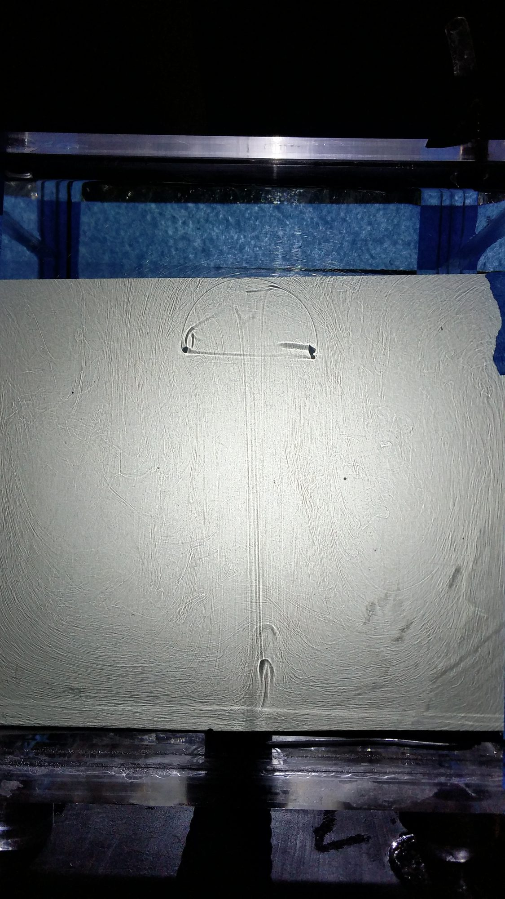
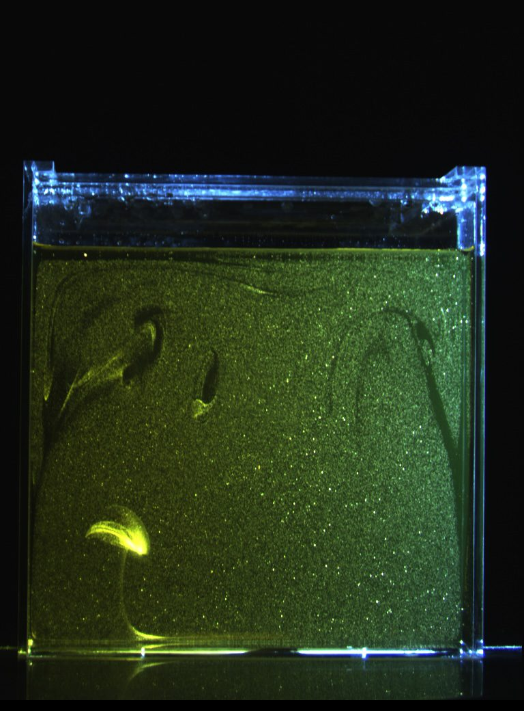
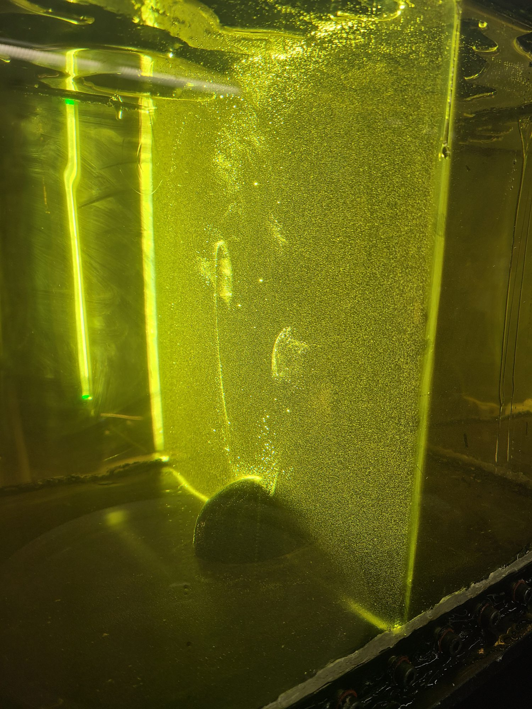

Images and videos from my laboratory experiments and simulations of mantle plumes. Click an image to enlarge it.

::: {.gallery-grid layout-ncol=2}

:::

### Visualizing a plume with thermochromic liquid crystals


