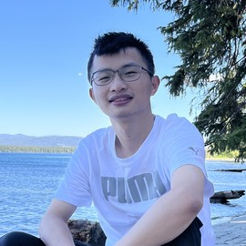
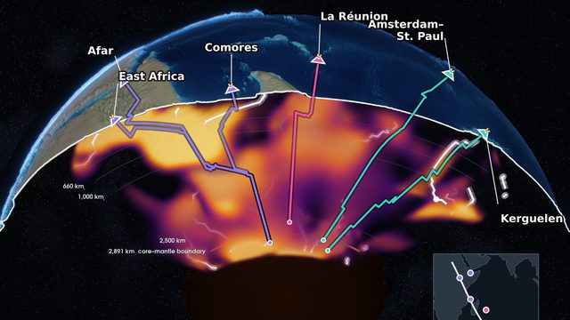
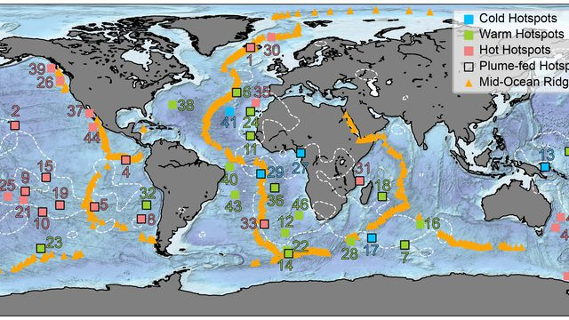
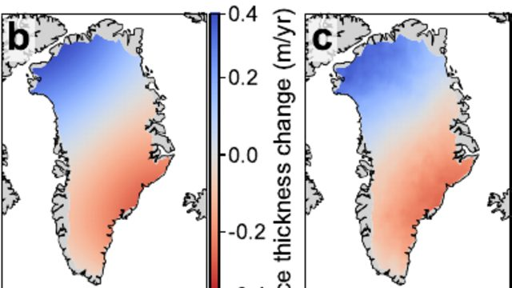
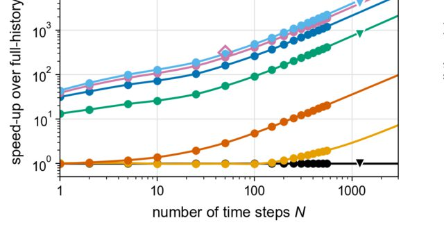

::: {.home-grid}

::: {.profile-card}


<div class="name">Xiyuan Bao<br>鲍习源</div>
<div class="role">Gordon and Betty Moore Foundation Postdoctoral Fellow, Department of Earth and Planetary Sciences, Harvard University</div>
<div>Research: Mantle Dynamics · Surface Processes and Interior–Surface Coupling · Machine Learning in Earth Science</div>

<div class="badge-list">
  <a class="icon-badge" href="mailto:xiyuanbao@fas.harvard.edu">
    <i class="fa-solid fa-envelope"></i><span>Email</span>
  </a>
  <a class="icon-badge" href="https://scholar.google.com/citations?user=g5YRtVAAAAAJ&hl=en" target="_blank">
    <i class="fa-solid fa-graduation-cap"></i><span>Google Scholar</span>
  </a>
  <a class="icon-badge" href="https://orcid.org/0000-0002-1363-3793" target="_blank">
    <i class="fa-brands fa-orcid"></i><span>ORCID</span>
  </a>
  <a class="icon-badge" href="https://github.com/xiyuanbao" target="_blank">
    <i class="fa-brands fa-github"></i><span>GitHub</span>
  </a>
  <a class="icon-badge" href="https://www.linkedin.com/in/xiyuan-bao/" target="_blank">
    <i class="fa-brands fa-linkedin"></i><span>LinkedIn</span>
  </a>

</div>
:::

::: {.right-col}
::: {.home-hero}
[Fire and ice: how Earth's deep interior shapes its surface]{.hero-tagline}

I study the coupled dynamics of Earth's interior and surface, from mantle plumes to sea-level rise, with simulations, experiments and machine learning.
I am a Gordon and Betty Moore Foundation Postdoctoral Fellow at Harvard University, with a PhD in geophysics from UCLA.

Learn more on the [Research](research.qmd) page.
:::


::: {.section-card}
### Featured work

```{=html}
<div class="featured-grid">
  <a class="featured-item" href="https://doi.org/10.1126/science.aea5466" target="_blank" rel="noopener">
    
    <span class="featured-meta">Science · 2026</span>
    <span class="featured-title">A joint geophysical–geochemical map of the deep mantle beneath East Africa and the Indian Ocean</span>
  </a>
  <a class="featured-item" href="https://doi.org/10.1126/science.abj8944" target="_blank" rel="noopener">
    
    <span class="featured-meta">Science · 2022</span>
    <span class="featured-title">Not all hotspots are hot: the relative temperatures of hotspots and mid-ocean ridges</span>
  </a>
  <a class="featured-item" href="https://arxiv.org/abs/2610.23748" target="_blank" rel="noopener">
    
    <span class="featured-meta">arXiv · 2026</span>
    <span class="featured-title">Neural operators reveal how much Greenland ice loss sea level fingerprint can recover</span>
  </a>
  <a class="featured-item" href="https://arxiv.org/abs/2610.23762" target="_blank" rel="noopener">
    
    <span class="featured-meta">arXiv · 2026 · Code</span>
    <span class="featured-title">SLEvolve: up to 4,000-fold faster sea-level modeling</span>
  </a>
</div>
```

See all on the [Publications](publications.qmd) page.
:::

::: {.section-card}
### News

::: {#latest-news}
:::


See more on the [News](news.qmd) page.
:::

::: {.section-card}
### Experience

- Gordon and Betty Moore Foundation Postdoctoral Fellow, Harvard University  
  <span style="float:right">Oct 2026–</span>  

- Reginald A. Daly Postdoctoral Fellow, Harvard University  
  <span style="float:right">Oct 2024–Sep 2026</span>  

- Postdoctoral Scholar, University of California, Los Angeles  
  <span style="float:right">Mar–Sep 2024</span>  

- Ph.D. in Geophysics, University of California, Los Angeles  
  <span style="float:right">2018–2024</span>  

- B.S. of Geophysics with Honors, University of Science and Technology of China  
  <span style="float:right">2014–2018</span>  

- Minor in Computer Science, University of Science and Technology of China  
  <span style="float:right">2014–2018</span>  

- Visiting Scholar, University of Illinois, Urbana-Champaign  
  <span style="float:right">Jun–Aug 2017</span>  
:::

:::
:::
