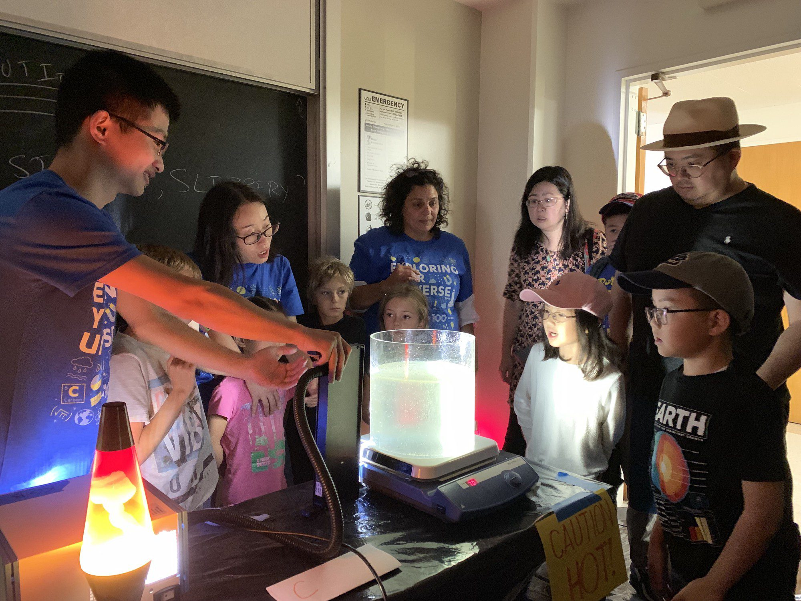

## In the media

::: {.media-item}
::: {.media-visual}
[{fig-alt="Harvard FAS story: Mapping source of volcanic activity deep within the Earth"}](https://current.fas.harvard.edu/stories/mapping-source-volcanic-activity-deep-within-earth)
:::
::: {.media-text}
[Harvard FAS · Sep 2026]{.media-meta}

### Mapping the source of volcanic activity deep within Earth

Interview about our 2026 *Science* paper, which combines graph theory and AI to build a joint geophysical–geochemical map of the deep mantle beneath East Africa and the Indian Ocean.

[Read the story](https://current.fas.harvard.edu/stories/mapping-source-volcanic-activity-deep-within-earth){.media-link}
:::
:::

::: {.media-item}
::: {.media-visual}
```{=html}
<div class="youtube-cover"
     onclick="this.innerHTML='<iframe src=&quot;https://www.youtube.com/embed/TtYIRvuanL0?autoplay=1&quot; title=&quot;YouTube video player&quot; allow=&quot;accelerometer; autoplay; clipboard-write; encrypted-media; gyroscope; picture-in-picture; web-share&quot; allowfullscreen></iframe>'">
  
  <div class="youtube-play-button">▶</div>
</div>
```
:::
::: {.media-text}
[Harvard Data Science Initiative · Video]{.media-meta}

### Reading Greenland's ice loss from sea level

Video interview about our project using machine learning and sea-level fingerprints to track Greenland ice loss.

[Watch on YouTube](https://www.youtube.com/watch?v=TtYIRvuanL0){.media-link}
:::
:::

::: {.media-item}
::: {.media-visual}
[{fig-alt="Global map of hotspot temperatures"}](https://doi.org/10.1126/science.abj8944)
:::
::: {.media-text}
[International press · Jan 2022]{.media-meta}

### Some volcanic hotspots are surprisingly cold

Coverage of our 2022 *Science* paper showing that not all hotspots are fed by hot mantle plumes.

[Science News](https://www.sciencenews.org/article/volcano-hot-spots-shallow-heat-source-tectonic-plates-mantle){.media-link}
[New Scientist](https://www.newscientist.com/article/2303622-plumes-of-rock-that-feed-volcanic-hotspots-are-surprisingly-cold/){.media-link}
[New Scientist (NL)](https://www.newscientist.nl/nieuws/vulkanische-hotspots-blijken-verrassend-koud/){.media-link}
[Popular Science](https://www.popsci.com/science/cool-volcanic-hotspots/){.media-link}
[Deutschlandfunk](https://www.deutschlandfunk.de/ueberraschende-ergebnisse-manche-vulkan-hotspots-sind-kuehl-dlf-9762e666-100.html){.media-link}
:::
:::

## Talks

::: {.media-item}
::: {.media-visual}

:::
::: {.media-text}
[IGCP 648 Virtual Seminar · Invited talk]{.media-meta}

### Are hotspots hotter than ridges?

A recorded seminar on how seismic tomography and mineral physics reveal the temperatures beneath volcanic hotspots and mid-ocean ridges.
:::
:::

## Outreach

::: {.media-item}
::: {.media-visual}
{fig-alt="Xiyuan showing plumes visualized with thermochromic liquid crystals and a lava lamp to visitors"}
:::
::: {.media-text}
[Explore Your Universe, UCLA · 2019–2022]{.media-meta}

### Why is Hawaii a volcano?

Explore Your Universe is the largest public science event in Los Angeles, with over 10,000 visitors each year.
Since 2019 I led a booth on hotspots like Hawaii, with hands-on demonstrations using thermochromic liquid crystals and a lava lamp, plus online tutorials for K-12 students and up.
The posts are hosted on my PhD group website, which I also built and maintained.

[EYU 2019](https://kgblab.epss.ucla.edu/post/eyu2019/){.media-link}
[EYU 2020](https://kgblab.epss.ucla.edu/post/eyu2020/){.media-link}
[EYU 2022](https://kgblab.epss.ucla.edu/post/eyu2022/){.media-link}
[Virtual booth on YouTube](https://www.youtube.com/channel/UCQo6tBGHTTPciBkJc2slDXw){.media-link}
:::
:::

::: {.outreach-list}
- **Invited outreach article.** *Rocks beneath volcanic hotspots can be surprisingly cool*, The Science Breaker, Jan 2022. [Read](https://www.thesciencebreaker.org/breaks/earth-space/rocks-beneath-volcanic-hotspots-can-be-surprisingly-cool){.media-link}
- **Lab tour for visitors from Tokyo Tech.** UCLA, Feb 2020. [Post](https://kgblab.epss.ucla.edu/post/jtech2020/){.media-link}
:::
