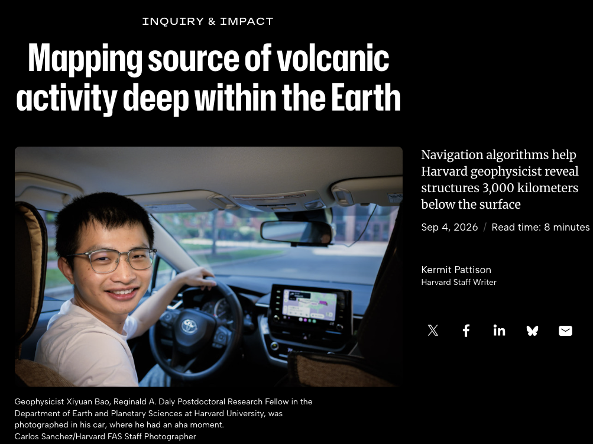
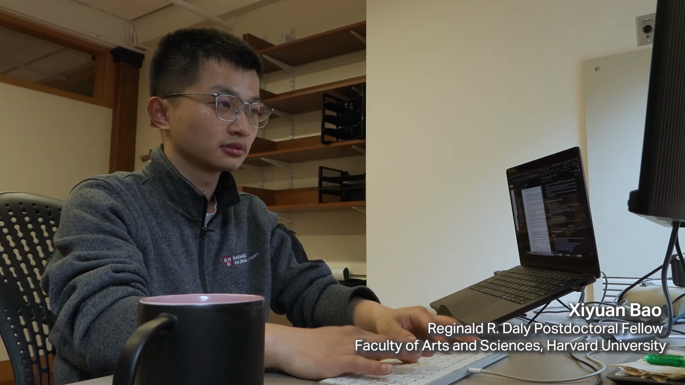

- **Media Interview of our 2026 Science paper on deep geophysical and geochemical map**

  [Harvard FAS](https://current.fas.harvard.edu/stories/mapping-source-volcanic-activity-deep-within-earth)
  

- **Harvard Data Science Initiative interview of our Greenland sea level fingerprint project**

</iframe>'">

  

  
▶

- **Media Interview of our 2022 Science paper on hotspot temperature**

  [Science News](https://www.sciencenews.org/article/volcano-hot-spots-shallow-heat-source-tectonic-plates-mantle)

  [New Scientist](https://www.newscientist.com/article/2303622-plumes-of-rock-that-feed-volcanic-hotspots-are-surprisingly-cold/)
  
  [New Scientist, Netherland](https://www.newscientist.nl/nieuws/vulkanische-hotspots-blijken-verrassend-koud/)

  [Popular Science](https://www.popsci.com/science/cool-volcanic-hotspots/)

  [Deutschlandfunk, Germany](https://www.deutschlandfunk.de/ueberraschende-ergebnisse-manche-vulkan-hotspots-sind-kuehl-dlf-9762e666-100.html)

- **Invited Talk at IGCP 648 Virtual Seminar: Are hotspot hotter than ridges?**  
  

- **Invited Outreach Article on cold hotspots**.

  Link: [The Science Breaker](https://www.thesciencebreaker.org/breaks/earth-space/rocks-beneath-volcanic-hotspots-can-be-surprisingly-cool)

- **Explore Your Universe (EYU)**

  

  EYU  is the largest public science outreach event in Los Angeles with over 10,000 visitors each year.
  I led a booth at EYU about hotspots like Hawaii since 2019, providing hands-on experience and online tutorials to K-12 and up.
  Check out the posts below, hosted on my PhD group website (which was also created and maintained by me).  
  [EYU2019](https://kgblab.epss.ucla.edu/post/eyu2019/) 
  [EYU2020](https://kgblab.epss.ucla.edu/post/eyu2020/)
  [EYU2022](https://kgblab.epss.ucla.edu/post/eyu2022/)

  Below is a Youtube channel for our virtual EYU booth:
  
  [EYU Youtube](https://www.youtube.com/channel/UCQo6tBGHTTPciBkJc2slDXw)

- **Lab tour for vistors abroad**

  Check out this [post](https://kgblab.epss.ucla.edu/post/jtech2020/)