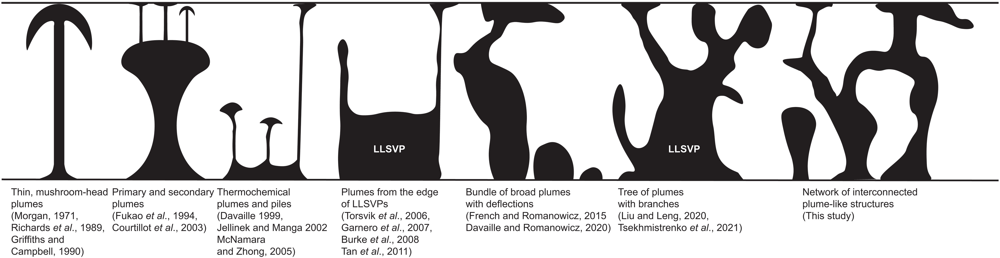

Our new study in [*Science*](https://www.science.org/eprint/JTMQ8ZYHF7UIWGFKZAHD/full?activationRedirect=/doi/full/10.1126/science.aea5466) uses graph theory to trace plausible mantle-plume pathways through seismic tomography beneath East Africa and the Indian Ocean.
By comparing these pathways with independent geochemicial data with AI-based clustering analysis, we identify at least three compositionally distinct source regions within the African LLSVP and construct the first joint geophysical-geochemical zoning map of the lowermost mantle in this region.

The work was also covered by [Harvard FAS](https://current.fas.harvard.edu/stories/mapping-source-volcanic-activity-deep-within-earth).
