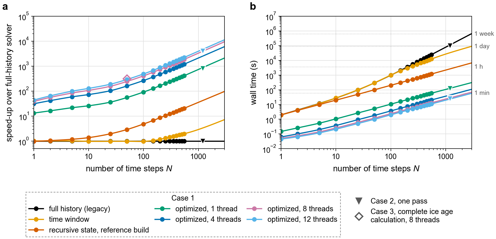
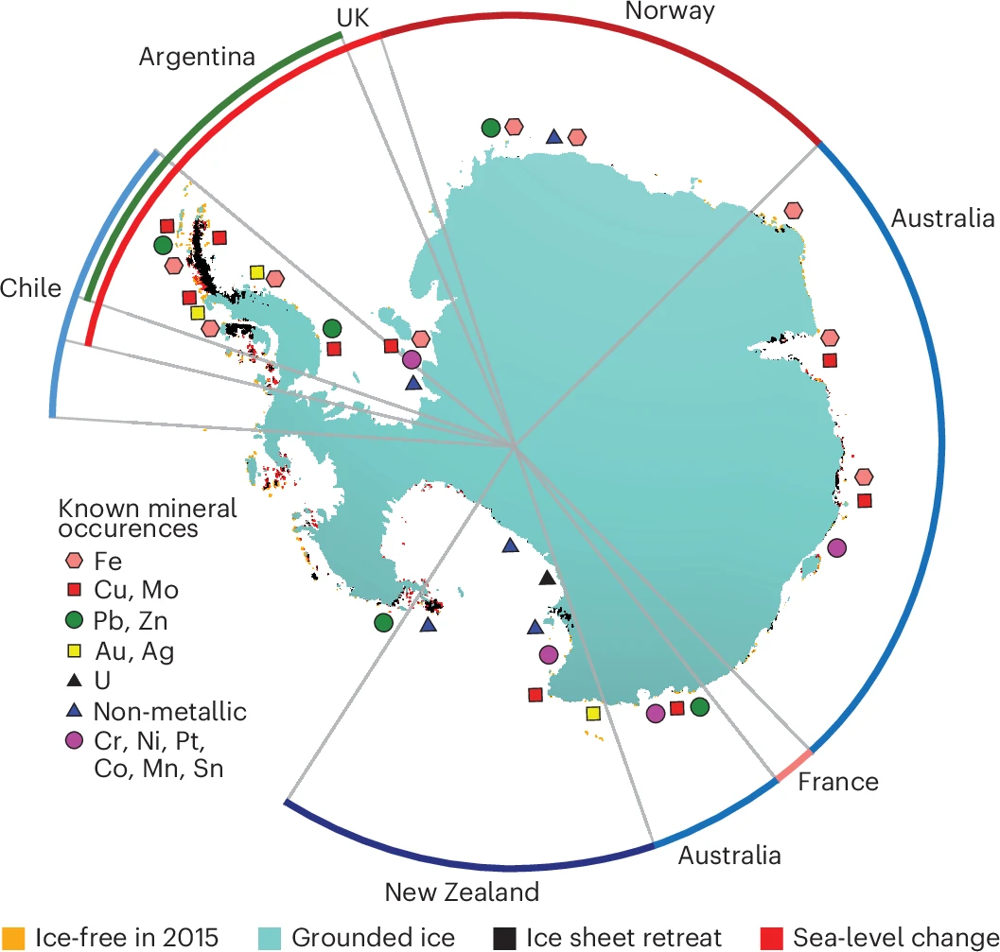

How do surface processes shape the environment we live in,
and how do they interact with the solid Earth interior, with implications for planetary evolution and habitability?

My work on surface processes and interior-surface coupling focuses on:

- The interplay among sea level change, cryosphere, and the solid Earth [@b5Coulson2025a;@a7Bao2025b].
Ice-mass redistribution perturbs Earth's gravity, rotation and solid surface and drives geographically variable sea-level change, a pattern known as a sea-level fingerprint.
Building on an inversion of sea-surface height for Greenland ice mass change [@b5Coulson2025a],
I developed a physics-informed neural operator (PI-DIFNO) that estimates ice loss directly from sea-level fingerprints and revealed scale-dependent limits on what can be recovered [@a7Bao2025b].

{fig-cap-location="bottom"}

- Accelerated glacial isostatic adjustment (GIA) modeling with [SLEvolve](https://github.com/xiyuanbao/slevolve) [@Bao2026c].
An exact finite-state representation of viscoelastic memory replaces the full load-history convolution in 1-D GIA solvers with recursively updated relaxation states,
reducing the history-dependent cost from O(N^2) to O(N). SLEvolve matches conventional solvers to machine precision with up to 4,000-fold acceleration,
opening the door to systematic exploration of ice histories and mantle viscosity.

{fig-cap-location="bottom"}

- Collaborations on the consequences of ice loss for people and the geological record [@b7Lucas2025a;@Powell2026;@Sylvie2026]:
Antarctic land and mineral-resource emergence in a warming world [@b7Lucas2025a], amplified sea-level rise in small island developing states [@Powell2026],
and early Pleistocene Red Sea shorelines linked to hominin dispersal out of Africa [@Sylvie2026].

{fig-cap-location="bottom"}

- Volatile cycling among different spheres of the Earth system over billions of years [@b6Bao2023d]

## Related Work

::: {#refs}
:::
