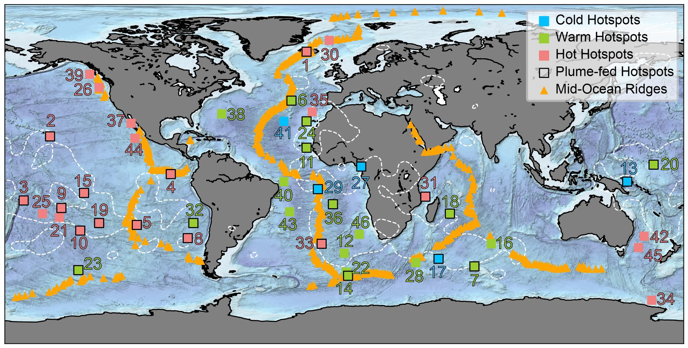
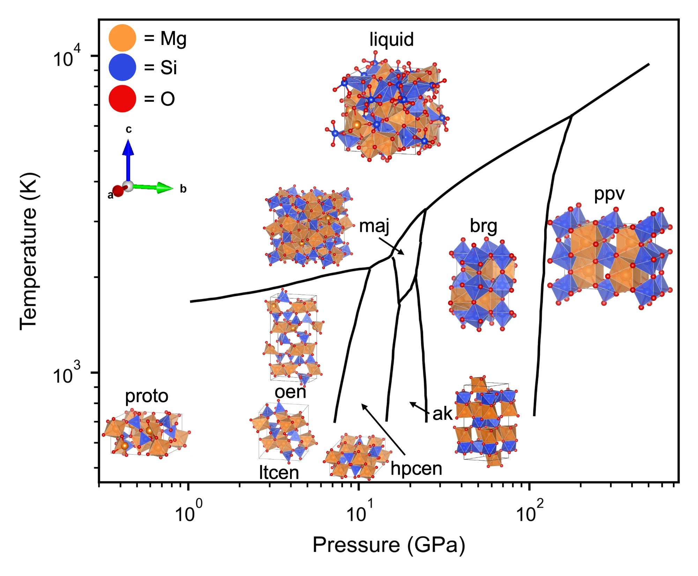

{fig-cap-location="bottom"}

**What is the present-day physical and chemical state of the solid Earth?
How did it dynamically evolve over geological time,
leaving behind the geological, geophysical and geochemical signatures across the globe?**

My research on solid Earth dynamics focuses on the following aspects:

- **Not all hotspots are hot.** Data-based interpretation of global volcanism, 
at hotspots [@c1Bao2022;@b6Cai2025a],
mid-ocean ridges [@aBao2024a; @a2Zhang2023a;@a1Zhang2023b] 
and subduction zones [@a0Li2023].

{fig-cap-location="bottom"}

- **Plumes in the lab.** Dynamical modeling of mantle plume evolution pathways, 
source entrainment and surface expressions [@Bao2024a;@b7Bao2023c;@b3Bao2025g].  

{fig-cap-location="bottom"}

- **Mapping the deep mantle.** Constraining the distribution of deep mantle heterogeneities and rheological properties [@a7Bao2025a;@bao2024giant].
Using a graph-theory framework to trace plausible plume pathways through seismic tomography, and clustering them jointly with lava isotopes, we built the first joint geophysical-geochemical zoning map of the lowermost mantle beneath East Africa and the Indian Ocean, resolving at least three domains within the African LLSVP [@a7Bao2025a].

{fig-cap-location="bottom"}

- **Mantle minerals and melts.** Structural controls on the properties of mantle minerals and melts, e.g. what makes MgSiO3 liquid resemble its crystalline polymorphs at the atomic scale [@Acquadro2026].

{fig-cap-location="bottom"}

{fig-cap-location="bottom"}

## Related Work

::: {#refs}
:::
