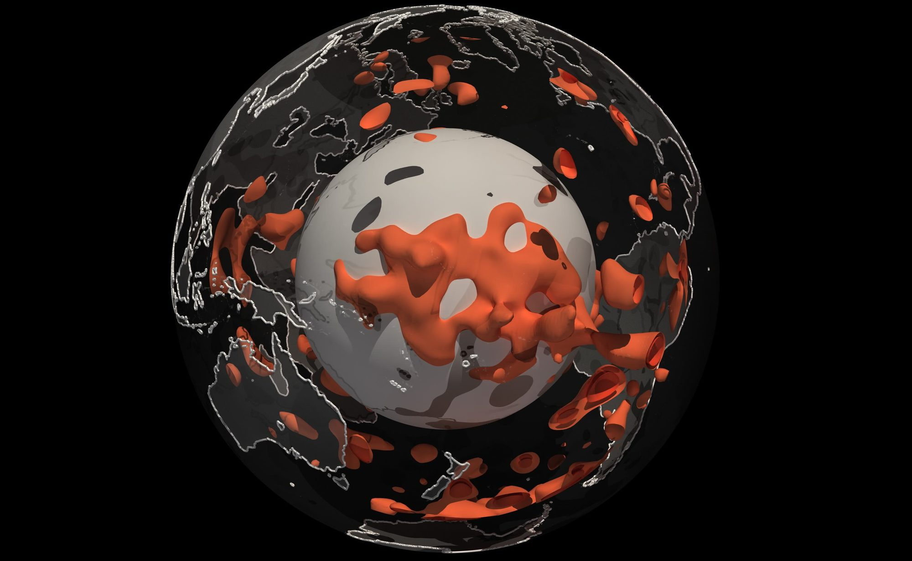
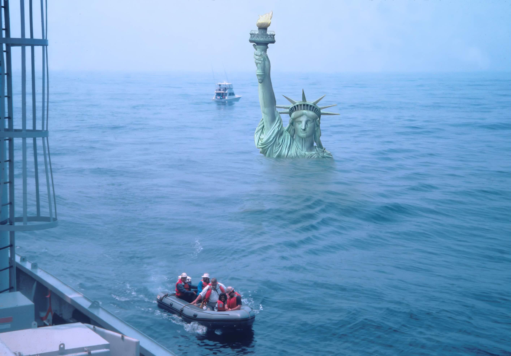

::: {.areas-grid}

::: {.area-card}

  
Solid Earth Dynamics

  
Where distinct reservoirs sit in Earth's mantle, and how plumes carry their signatures to volcanoes at the surface.

  
<a href="research-mantle.qmd">Read more →</a>

:::

::: {.area-card}

  
Surface Processes and Interior-surface Coupling

  
How ice sheets, sea level and the solid Earth shape one another, and what that means for coasts, resources and human history.

  
<a href="research-couple.qmd">Read more →</a>

:::

::: {.area-card}

  
Experimental, Computational and AI Methods in Geophysics

  
Laboratory 4D flow measurements, digital twins, neural operators and AI-agent-modernized solvers for geophysics.

  
<a href="research-methods.qmd">Read more →</a>

:::

:::