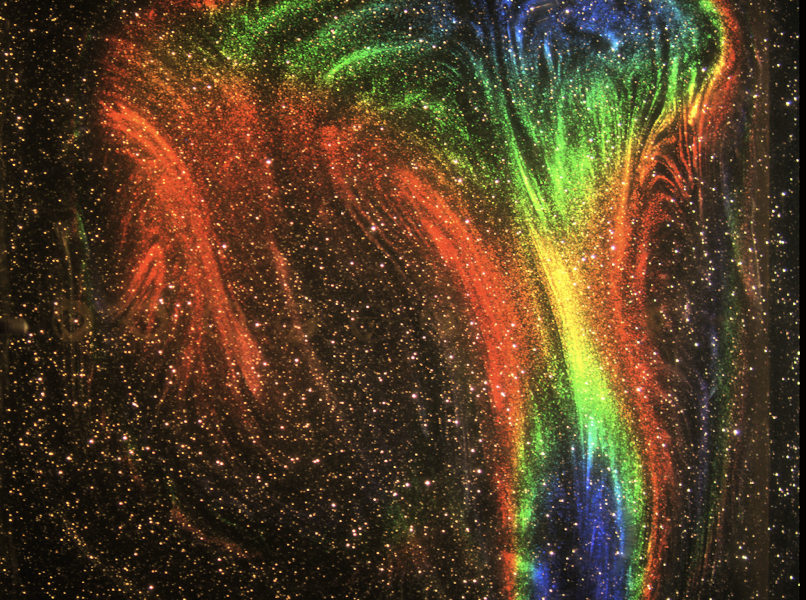

::: {.areas-grid}

::: {.area-card}

  
Solid Earth Dynamics

  
Mapping where distinct mantle reservoirs sit, how plumes sample them, and how they shape volcanism at hotspots, mid-ocean ridges and subduction zones, using geodynamical modeling, laboratory experiments and geophysical and geochemical observations.

  
<a href="research-mantle.qmd">Read more →</a>

:::

::: {.area-card}

  
Surface Processes and Interior-surface Coupling

  
How ice sheets, sea level and the solid Earth respond to one another across timescales, from sea-level fingerprints and glacial isostatic adjustment to volatile cycling, with implications for planetary evolution and habitability.

  
<a href="research-couple.qmd">Read more →</a>

:::

::: {.area-card}

  
Experimental, Computational and AI Methods in Geophysics

  
Developing laboratory 4D flow measurements, hybrid-adjoint digital twins, fast physics-based solvers and neural operators to analyze, simulate and invert complex geodynamic systems.

  
<a href="research-methods.qmd">Read more →</a>

:::

:::